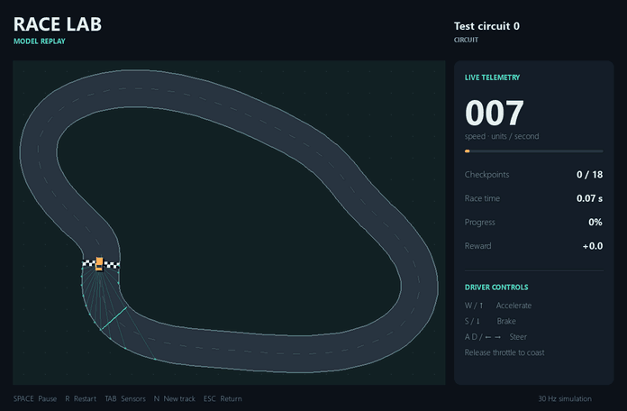
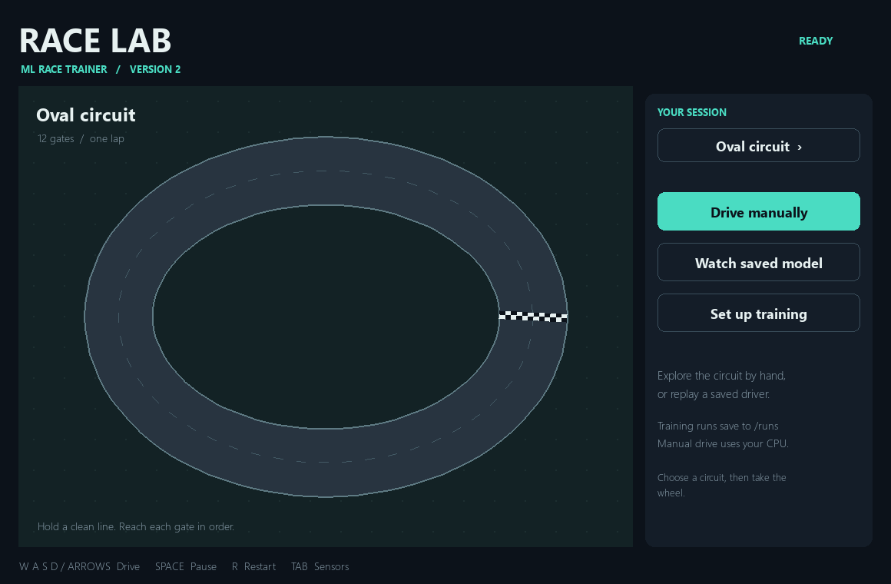
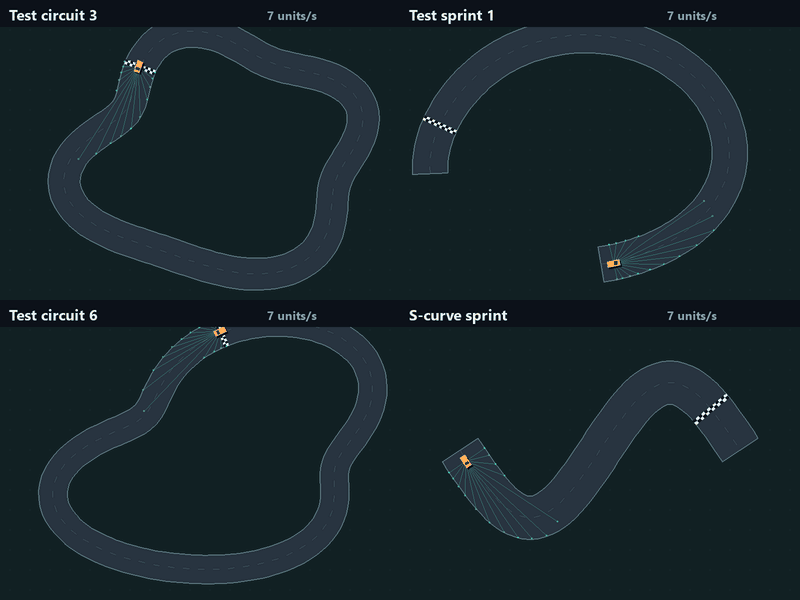
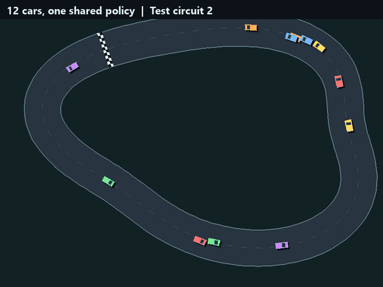

# Race Lab · ML Race Trainer

A racing and reinforcement-learning lab. Cars learn to drive from their own sensors, train
headlessly on generated tracks, and are then tested on tracks they have never seen.
You can also drive by hand and watch any trained model on any track.



*A trained model (`runs\v3-default`, one million steps) on a test circuit it never saw in
training. The faint lines are its 15 wall-distance sensors, which are all it can see.*

Version 3 changed what the car sees and how it trains:

- **Sensors only.** The policy reads 15 wall-distance rays, its speed, and its previous
  controls. It gets no map, centerline, or lap-progress input, so it cannot memorize a track.
- **Generated tracks.** Training draws from a pool of 512 generated layouts. The three
  hand-built layouts and all evaluation layouts are held out.
- **Headless and fast.** 64 cars are simulated at once and one learner trains on all of
  them. A default run is one million steps; see [validation](docs/VALIDATION.md) for
  measured times and results.

Opening the app shows a menu. Training starts only through **Start training** or an explicit
`train` command.

For continuing development in a new editor or coding tool, start with the
[project handoff](docs/HANDOFF.md), [project instructions](AGENTS.md), and
[documentation index](docs/README.md).



## Start on Windows

Install [uv](https://docs.astral.sh/uv/getting-started/installation/) if needed. From this folder:

```powershell
# Install NVIDIA CUDA support. Setup runs no GPU workload or training.
powershell -ExecutionPolicy Bypass -File .\setup.ps1 -Device cuda

# Double-click Launch Race Lab.cmd, or from this folder:
.\race app
```

`race.cmd` runs any command below with the installed environment, so nothing needs to be
set up in the terminal first. Run it from this folder (relative paths such as `runs\...`
are resolved here). The equivalent long form is
`& "$env:LOCALAPPDATA\RaceTrainer\venv\Scripts\python.exe" -m race_trainer <command>`.

Use `-Device cpu` for a smaller CPU-only installation. Setup uses Python 3.12 and `uv.lock`.
Its environment lives under `%LOCALAPPDATA%\RaceTrainer\venv`, so large Python/CUDA files
stay outside OneDrive. It does not modify global Python. The launcher also supports a
conventional project `.venv` when the local runtime is absent.

On other platforms, run `uv sync --locked --python 3.12 --extra cpu`, then use the Python
executable inside `.venv`. Do not install `pygame` alongside `pygame-ce`; both provide the
same `pygame` import. Pip fallback files are provided, but uv uses the full dependency lock.

## Train, test, watch

```powershell
# 1. Train headlessly on generated tracks (starts training when invoked).
.\race train --output runs\my-run

# 2. Score the result on tracks it never trained on.
.\race evaluate --model runs\my-run\best.pt

# 3. Watch it drive an unseen track. Press N for another one.
.\race watch --model runs\my-run\best.pt
```

`runs\my-run` exists only after step 1. If a model path is wrong, `watch` and `evaluate`
list the `runs\*\best.pt` files that do exist.



*The same model on three generated test tracks and the hand-built S-curve, none of which
it trained on. All four finish.*

`train` prints a progress line every 20,000 steps and scores the model on 16 unseen
validation tracks every 100,000 steps. The weights that finish the most of them are kept
as `best.pt`; on a tie the newest wins.

`evaluate` drives the three built-in layouts plus 20 generated test layouts and prints a
table: finish rate, crash rate, progress, lap time, and speed per track, with a column
saying whether the model trained on that track. It ends with the count of runs finished
and, for each failure, the `watch` arguments that replay it. Choose your own set with
`--tracks`:

```powershell
.\race evaluate --model runs\my-run\best.pt --tracks oval square random:12345
.\race evaluate --model runs\my-run\best.pt --generated 200 --episodes 2 --output artifacts\report.json
.\race watch --model runs\my-run\best.pt --track s_track
```

## Tracks

A track is a built-in name or `random:<seed>`. Every seed is a different, reproducible
layout: a circuit or a point-to-point sprint with its own width, corners, and direction.

| Tracks | Role |
| --- | --- |
| `random:0` to `random:511` | Default training pool (`train --tracks random`) |
| `random:1000000000` onward | Validation: scored during training to choose `best.pt` |
| `random:2000000000` onward | Test: used by `evaluate`, `watch`, and the app menu |
| `oval`, `s_track`, `square` | Hand-built layouts, held out of default training |

```powershell
.\race tracks
.\race render --track random:7 --output artifacts\track.png
.\race manual --track random:2000000003
```

To train on specific tracks instead, name them: `--tracks oval square`, or mix them with
the pool: `--tracks random oval`. `evaluate` marks any track the model trained on.

## Training options

Inspect the configuration without constructing an agent or starting a run:

```powershell
.\race train --dry-run
```

| Flag | Default | Meaning |
| --- | --- | --- |
| `--steps` | 1,000,000 | Total environment steps across all cars |
| `--envs` | 64 | Cars simulated in parallel |
| `--tracks` | `random` | Training tracks; `random` is the generated pool |
| `--track-pool` | 512 | Number of generated layouts in the pool |
| `--device` | `auto` | `auto`, `cuda`, or `cpu` |
| `--seed` | 42 | Network initialization, exploration, and track order |
| `--steering-noise` | 0.2 | Steering error added while training, so the car learns to leave a margin |
| `--eval-every` / `--log-every` | 100,000 / 20,000 | Steps between evaluations / progress lines |
| `--output` | `runs\<timestamp>` | New run directory; never overwrites |
| `--json` | off | Print events as JSON lines instead of readable text |

Further flags: `--max-steps`, `--batch-size`, `--learning-rate`, `--learning-starts`,
`--exploration-steps`, `--eval-episodes`, and `--cpu-threads`.

Each run directory holds:

| File | Contents |
| --- | --- |
| `config.json` | Configuration, chosen device, and resume source |
| `metrics.jsonl` | Progress events: finish/crash rates, loss, exploration, speed |
| `evaluations.jsonl` | Validation reports, including every episode |
| `best.pt` | Best validation result so far |
| `latest.pt` | Latest resumable state |

Use **Stop & save**, close the training monitor, or press Ctrl+C in a training terminal to
save `latest.pt`. A `stop.request` file in the run directory does the same.

```powershell
.\race train --resume runs\my-run\latest.pt --steps 2000000 --output runs\my-run-2
```

`--steps` is the total target, including completed steps. Resume preserves seed, tracks,
physics, and learning settings and creates a new run directory. Checkpoints contain both
networks, Adam state, replay, counters, random state, configuration, and the
observation/action versions. Cars restart on resume; their earlier experience stays in replay.

## Devices and speed

| Option | Behavior |
| --- | --- |
| `--device auto` | CUDA when available and Windows reports external power; otherwise CPU |
| `--device cuda` | The learner uses the NVIDIA GPU; errors clearly if unavailable |
| `--device cpu` | Everything on the CPU |

`auto` is the default for training. Watching and evaluating default to CPU, which is
fastest for this small network. The simulator always runs on the CPU.

```powershell
.\race benchmark
.\race doctor
```

`benchmark` takes under a minute. It measures the simulator alone, the learner alone on
each device, and then the real training loop on each device, and names the fastest.
`doctor` reads package, power, and CUDA metadata without running any workload.

## Drive it yourself

```powershell
.\race manual --track s_track
```

| Control | Action |
| --- | --- |
| W / Up | Accelerate |
| S / Down | Brake |
| A D / Left Right | Steer |
| Release throttle | Coast |
| Space | Pause |
| R | Restart with the same episode seed |
| N | Switch to the next unseen generated track |
| Tab | Toggle sensors |
| Esc | Return to the menu |
| Enter, after a model episode | Next replay episode / finish replay |

Tyres have limited grip: at speed the car cannot turn as sharply, so tight corners need
braking. Gates count only in sequence and in the correct direction. A sprint's finish line
sits a braking distance before the end of the road. Speed is in simulation units per second.

## What the model is



*Twelve cars share one policy, started at random points as in training. Cars do not
collide with each other; each one reacts only to its own sensors.*

- **Inputs (18):** 15 rays from -90 to +90 degrees, denser toward the front; speed; previous
  steering; previous throttle.
- **Outputs (15):** accelerate, coast, or brake, each with one of five steering angles.
- **Learner:** dueling Double DQN with 3-step returns, Huber loss, and an annealed
  learning rate. Updates run on the GPU while the CPU simulates the next step.
- **Reward:** distance travelled along the track, a small penalty for jerky steering, a
  crash penalty, and a finish bonus.

Crashes and finishes end an episode. Time limits and stalls cut it short without
pretending the future was worthless. Details are in [architecture](docs/ARCHITECTURE.md)
and the [reference](docs/REFERENCE.md).

## Older models and scripts

Your original `best_race_model.pth` is preserved and still rejected: its seven inputs match
no later version. Version 2 checkpoints are also rejected, because they relied on centerline
guidance the car no longer receives. Train a version 3 model instead; it takes minutes.
The recovered original code is committed at `c940c81` for historical comparisons.

Old script names are adapters: `main.py`, `simple_main.py`, and `debug_main.py` open the
menu; training scripts without arguments print help. `watch_model.py` and
`test_generalization.py` forward to `watch` and `evaluate`. `quick_test.py` reads diagnostics.

## Development

```powershell
$racePython = Join-Path $env:LOCALAPPDATA 'RaceTrainer\venv\Scripts\python.exe'
& $racePython -m pytest -q
& $racePython -m ruff check .
& $racePython -m ruff format --check .
```

The default suite forces CPU operation, blocks backpropagation and Adam updates, and skips
GPU tests. It covers track generation, geometry, agreement between one car and many,
Gymnasium contracts, n-step replay, checkpoints, the headless loop with learning switched
off, the CLI, and the desktop monitor with a fake child process. CI runs these CPU checks
on Windows and Linux.

To run the bounded CUDA checks on a machine with the CUDA runtime installed:

```powershell
& $racePython -m pytest -q -m gpu --run-gpu
```

These execute real GPU learning in tiny disposable runs. They verify the pipeline; they do
not produce a trained driver. See [development](docs/DEVELOPMENT.md).

References: [Gymnasium time limits](https://gymnasium.farama.org/tutorials/gymnasium_basics/handling_time_limits/),
[PyTorch installation](https://pytorch.org/get-started/locally/), and [pygame-ce](https://pyga.me/docs/).
