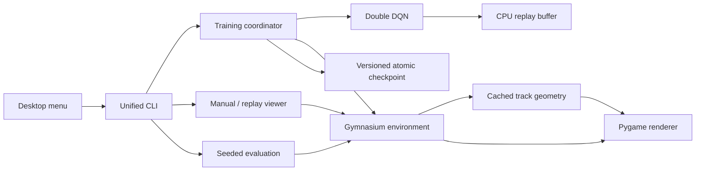

# Architecture

## Module boundaries

- `config.py`: serializable settings and observation/action versions.
- `tracks.py`: centerline, road polygons, vectorized raycasts, projection, and gates.
- `environment.py`: dynamics, observations, rewards, and termination; no ML imports.
- `agent.py`: networks, replay, Double DQN targets, exploration clock, and optimization.
- `checkpoint.py`: tensor/primitives loading, compatibility checks, atomic saves, and inference.
- `training.py`: the sole learning coordinator, logging, evaluation, and stop/resume.
- `evaluation.py`: deterministic inference-only episodes and summaries.
- `rendering.py`, `viewer.py`, `app.py`: presentation, controls, and process monitoring.
- `device.py`: CPU/CUDA selection and metadata-only diagnostics.
- `cli.py`, `legacy.py`: commands and compatibility adapters.

## Policy contract

Observation version 2 contains 13 float32 values: nine normalized wall distances, normalized
speed, sine/cosine of heading relative to a centerline lookahead, and normalized lateral
offset. The policy receives centerline guidance; this is a driving/control experiment,
not a camera-only perception model.

Action version 2 uses throttle-major order: throttle `1`, `0`, `-1`, each paired with steering
`-1`, `0`, `1`. Negative throttle brakes, without reversing. The environment accepts a
continuous pair; DQN chooses from this nine-action table.

The default network is `13 -> 128 -> 128 -> 128 -> 9` with ReLU hidden activations. CPU replay
holds 50,000 transitions. Learning begins at step 2,000, uses batches of 128 every fourth
environment step, and synchronizes the target every 1,000 optimizer updates. Epsilon stays
at 1 during warm-up, then decreases to 0.05 over 100,000 environment steps. Online values
choose the next action and target values evaluate it. Training uses Huber loss and clips
gradient norm to 10.

## Reward and ending rules

Reward is signed centerline advance / 12, minus 0.02 per step and 0.01 times steering change,
plus 2 per ordered gate and 20 at the finish. A crash subtracts 10. Arc progress avoids the
old discontinuity when changing target checkpoints. A reverse or skipped gate cannot count.

The same polygons supply drawing, sensor intersections, and corner collision checks. Two
physics substeps and a bounded maximum displacement preserve collision resolution.

Crashes and finishes terminate. Time limits and stalls truncate. Only terminal transitions
suppress the Bellman bootstrap. The coordinator resets after either ending.

## Reproducibility and limits

Training rotates through configured tracks and seeds resets with `seed + episode`. Evaluation
uses fixed seeds beginning at `100000 + seed`, disables exploration, and does not consume the
agent's exploration RNG. Best checkpoints rank completion rate, then checkpoint fraction,
then mean reward. These are three fixed layouts; this does not prove arbitrary-track generalization.

Checkpoints restore networks, optimizer, replay/cursor, random states, and counters. Clean
episode boundaries preserve the learning state. A partial interrupted episode restarts on
resume, retaining experience already in replay. Devices or library versions may produce
different numerical learning trajectories.

CUDA accelerates network operations; simulation and replay storage stay on CPU. CPU is the
default. Bounded CUDA checks now exercise inference, learning, checkpoint restore, and the
desktop subprocess. They do not establish convergence, driving quality, or a GPU speedup.
See [the validation record](VALIDATION.md) for the measured scope and results.

Optimizer restore copies its state before passing it to PyTorch. Adam can otherwise retain
CPU step tensors shared with the loaded checkpoint or another restored agent, so advancing
one optimizer could change another agent's counters.
