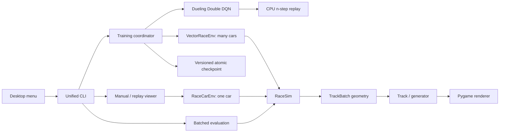

# Architecture

## Module boundaries

- `config.py`: serializable settings, policy contract versions, track naming, seed ranges.
- `tracks.py`: `Track`, the generator, and the batched geometry queries.
- `simulation.py`: `RaceSim`, the only implementation of physics, sensors, rewards, endings.
- `environment.py`: `RaceCarEnv` (one car, Gymnasium) and `VectorRaceEnv` (training).
- `agent.py`: network, replay, n-step targets, exploration, optimization.
- `checkpoint.py`: compatibility checks, atomic saves, and inference loading.
- `training.py`: the sole learning coordinator: logging, evaluation, stop/resume.
- `evaluation.py`: deterministic greedy episodes, run as one batch.
- `benchmark.py`: short throughput measurements.
- `rendering.py`, `viewer.py`, `app.py`: presentation, controls, and process monitoring.
- `device.py`: CPU/CUDA selection and metadata-only diagnostics.
- `cli.py`, `legacy.py`: commands and compatibility adapters.

## Why version 3 exists

Version 2 trained poorly and could not show generalization. Three causes were found:

1. **The policy was handed the map.** Its inputs included the heading to a centerline
   lookahead point and the lateral offset from the centerline. A car can follow those
   without using its wall sensors, and they are not something a car carries.
2. **Three fixed layouts, one start line.** Every episode began at the same place, so
   whatever was learned could be specific to those corners.
3. **Exploration stood still.** A uniformly random action brakes harder than it
   accelerates, so during the fully random phase the car barely moved and the replay
   filled with standstill transitions.

It was also slow: one car stepped in Python, a small batch per update, CPU by default.

## Policy contract

Observation version 3 is 18 float32 values, all measurable on the car: 15 normalized wall
distances, normalized speed, and the previous steering and throttle. Nothing depends on
gates, lap progress, or the centerline; a regression test moves those and checks the
observation is unchanged. The previous controls are included because the reward penalizes
steering changes, which would otherwise depend on something the policy cannot see.

Action version 3 is a 15-entry table: throttle `1`, `0`, `-1`, each paired with steering
`-1`, `-0.5`, `0`, `0.5`, `1`. Negative throttle brakes without reversing. The simulator
accepts a continuous pair; the agent chooses from the table.

The network is `18 -> 256 -> 256` with ReLU, then a dueling head: one state value and 15
advantages.

## One simulator for one car or many

`RaceSim` holds the state of N cars as arrays and advances them together. `RaceCarEnv` is
N = 1 and exposes that car's state for rendering and manual driving. `VectorRaceEnv` is
N = 64 by default and restarts each finished car on a newly drawn track. A regression test
drives six cars in one batch and the same six alone and requires identical observations,
rewards, endings, and info.

Geometry is written once, in batched form, in `tracks.py`: raycasts, an even-odd on-road
test over all boundary segments, centerline projection, and gate crossings. `Track` calls
those functions with a batch of one; `TrackBatch` pads many tracks to a common size and
calls the same functions. The polygons drawn on screen are the ones raycast and collided
with. Padding is placed far away with zero extent so it can never be hit.

The raycast dominates simulator time. It processes environments in cache-sized slices and
reuses temporaries; each element sees the same arithmetic whatever the batch, which keeps
the one-car and many-car results bit-identical.

## Tracks

`random:<seed>` builds a closed curve from a few random polar harmonics, scales it into the
800 by 600 canvas, and resamples it at 12-unit spacing. A candidate is rejected if any
corner is tighter than `max(half_width + 18, 55)`, if two stretches come closer than the
road width plus a margin, or if it leaves the canvas. Most seeds keep the twistiest of
three valid candidates, so S-bends are common; the rest keep the first, so simple ovals
exist too. Direction is random, width is 28 to 44, and one seed in five becomes a sprint by
keeping an open stretch of a valid loop.

Seed ranges separate the roles: training pool below one billion, validation from one
billion, test from two billion. The hand-built layouts are not in the default pool.

A sprint ends in a wall. Its finish line is 100 units before that wall. A car that reads
only its sensors cannot tell a finish from a dead end; with the line right at the wall the
learned policy braked and stalled short of it. With run-off it crosses the line at speed.

## Physics and reward

Speed changes by throttle, braking, and constant drag. Turning follows a bicycle model, with
yaw rate capped at `grip / speed`: above that the car runs wide instead of turning, so
tight corners need braking. Each step uses two movement substeps and tests all four car
corners after each.

Reward per step is `0.05` per unit advanced along the centerline, minus `0.01` times the
change in steering, minus `5` on a crash, plus `5` at the finish. Advance wraps on circuits
and is clipped to what the car could have moved. There are no per-gate bonuses: gate
spacing differs between tracks and would make the same driving worth different amounts.

Crashes and finishes terminate. Time limits and stalls (no new progress for 120 steps)
truncate. Only termination suppresses the Bellman bootstrap.

## Learning

- **Double DQN:** the online network picks the next action, the target network values it.
- **n-step returns (n = 3):** replay is a time-ordered ring of shape (horizon, cars). A
  sample follows its own car forward up to three steps, stopping at an episode end, at the
  newest stored step, or at a resume boundary, and bootstraps from that step's successor.
- **Exploration:** epsilon falls linearly from 1 to 0 over 300,000 steps after warm-up, but
  each car has its own floor, spread geometrically from 0.4% to 6%. A random action is
  drawn with a bias toward throttle and straight steering and is held for about four
  steps, because single-step noise at 30 Hz averages out to nothing.
- **Schedule:** 20,000 warm-up steps, then one update of 2,048 transitions per 64
  environment steps. The target network is copied every 100 updates. Huber loss, gradient
  norm clipped at 10.
- **Learning rate:** Adam, annealed linearly from 3e-4 to 3e-5 over the run. At a constant
  rate the greedy policy kept shifting late in training and occasionally became markedly
  worse for a while; annealing settles it. See the validation record.
- **Random starts:** in training a car starts at a random point along the track with a
  small lateral and heading offset. Evaluation always starts on the line.
- **Steering noise:** in training the executed steering is the chosen steering plus
  Gaussian noise (0.2 of full lock). Q-learning values the best action as if it will be
  executed perfectly, so without noise the policy learns lines with no margin and
  crashes on unfamiliar corners. With imprecise steering those lines stop paying off
  and the policy keeps a margin. Evaluation, watching, and manual driving have no noise.

## Sized for the hardware

On the recorded laptop each CUDA call costs tens of microseconds, far more than the
arithmetic of this small network. Measurements drove five choices:

1. The simulator is batched NumPy, not one Python object per car.
2. Replay stays on the CPU and each update makes one packed host-to-device copy.
3. Batches are large. An update costs about the same at 512 as at 2,048 transitions, so
   fewer, larger updates learn from four times as many samples per second.
4. The cars are driven by a CPU copy of the network, refreshed every four updates. A GPU
   round trip to choose 64 actions was slower than doing it on the CPU.
5. The simulator and the learner run at the same time. Each update is handed to a worker
   thread and runs while the main thread simulates the next step; NumPy and PyTorch both
   release the interpreter lock during their heavy work. The minibatch is drawn on the
   main thread before the hand-off, the update is collected before the next one is drawn,
   and the driving copy is refreshed only in between, so the outcome does not depend on
   thread timing. Two identical runs produce identical weights.

`benchmark` repeats these measurements on any machine. See
[the validation record](VALIDATION.md) for numbers.

## Reproducibility and limits

Evaluation is greedy, starts every car on the line with a seeded offset, and runs all
(track, seed) pairs as one batch. The same seed in `watch` reproduces an evaluated episode.
Best checkpoints rank completion rate, then mean progress, on validation tracks only, and
the newest of equal leaders is kept. Pace is not ranked: ranking by speed selected early,
aggressive models that crashed more on the test tracks. The test tracks play no part in
training.

Checkpoints restore networks, optimizer, replay, random states, and counters. Cars are not
serialized mid-episode: on resume every car restarts on a new track and the replay marks a
break so earlier steps do not chain into the new episodes. A resumed run is therefore not
bit-identical to an uninterrupted one. Devices or library versions may also produce
different numerical trajectories.

Generalization here means new layouts from the same generator, plus the three hand-built
ones. Tracks with features the generator never produces, such as hairpins that double
back, crossings, or much narrower roads, are untested.

Optimizer restore copies its state before passing it to PyTorch. Adam can otherwise retain
CPU step tensors shared with the loaded checkpoint or another restored agent, so advancing
one optimizer could change another agent's counters.
